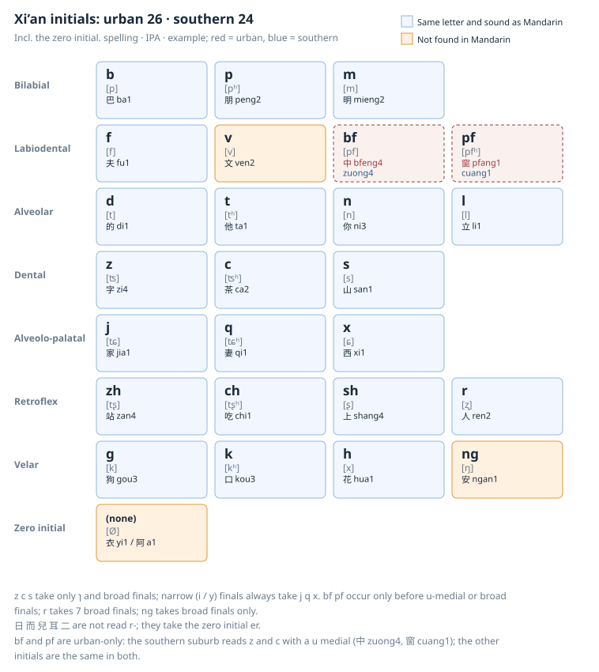
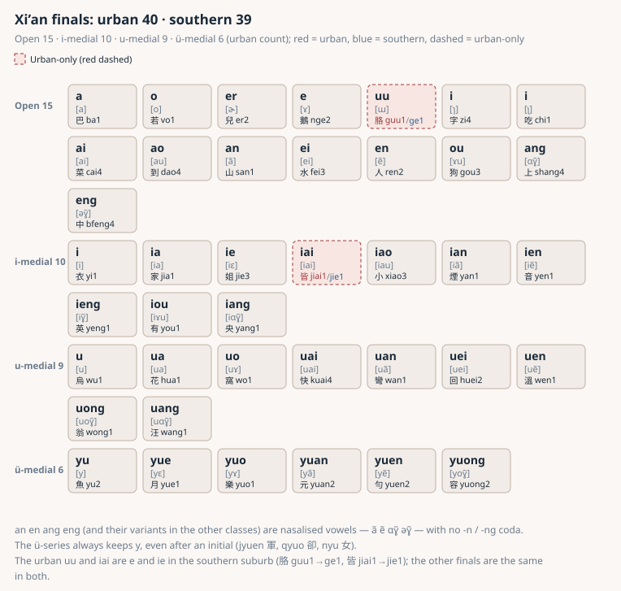
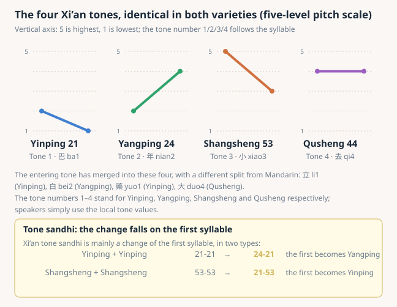
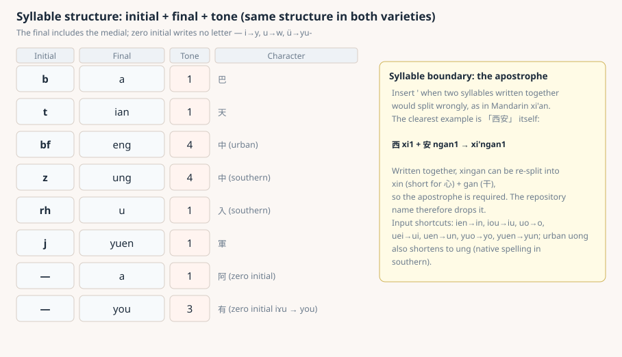

[简体中文](README.md) ｜ [繁體中文](README.zh-Hant.md) ｜ **English** ｜ [日本語](README.ja.md)

# Xi'an Dialect Input Method · Android build · android-xinganhua

> The Xi'an dialect input method as a ready-to-install Android package: install the **Fcitx5 for Android** app and its **Rime plugin**, switch to 「中州韵」 and pick 「西安話城區音」 or 「西安話南郊音」 — then type Xi'an dialect with Xi'an pinyin. No scheme files to import by hand.

- **Platform**: Android 6.0 and later (minSdk 23); four ABIs: `arm64-v8a` / `armeabi-v7a` / `x86` / `x86_64`
- **What is published**: 8 APKs = the app × 4 ABIs + the Rime plugin × 4 ABIs, all signed with the same key
- **Built-in schemes**: `chengqyu` (urban Xi'an) and `nanjiao` (southern-suburb Xi'an), installed into `rime-data` by the plugin and listed first in the schema menu
- **Package name**: `org.fcitx.fcitx5.android` (same as the official app, different signature — uninstall the official one first)
- **Scheme source**: [xinganhua-fuvufa](https://github.com/SiqYin/xinganhua-fuvufa) (read-only reference; this repository does not change the scheme)
- **Four languages**: Simplified Chinese / Traditional Chinese / English / 日本語 — switch with the links above; all four say the same thing, and the Simplified version is authoritative

---

## Contents

1. [The Xi'an pinyin scheme](#s1)
2. [What this is](#s2)
3. [Download and install](#s3)
4. [How the scheme is built in](#s4)
5. [Relationship to the scheme repository](#s5)
6. [Building it yourself](#s6)
7. [Upstream and credits](#s7)
8. [License](#s8)

---

<a id="s1"></a>

## 1. The Xi'an pinyin scheme

The phone build, the desktop Rime package and both web repositories all use the same **Xi'an pinyin**. A syllable is initial + final + tone digit, e.g. `ba1` 巴, `bfeng4` 中, `jyuen1` 軍:

- **Initials**: 24 shared (including the zero initial), plus `bf`, `pf` in the urban variety (26 in all) and `rh` in the southern variety (25 in all): `b p m f v bf pf d t n l z c s rh j q x zh ch sh r g k h ng`
- **Finals**: 38 shared (15 open / 8 i-medial / 9 u-medial / 6 ü-medial), plus `uu`, `iai` in the urban variety — 40 in all (16 / 9 / 9 / 6)
- **Four tones**: Yinping 21, Yangping 24, Shangsheng 53, Qusheng 44; the entering tone has merged into these four
- **The tone digit follows the syllable** with no space: `bfeng4` 中, `jyuen1` 軍
- **Syllable boundaries use an apostrophe**: `xi'ngan1` 西安 (otherwise it would split into xin 心 + gan 干)
- **Abbreviations (input side only)**: `in / ing / iu / ui / un / ung / yun / yung` stand for `ien / ieng / iou / uei / uen / uong / yuen / yuong` (the zero initial only allows `yuen`, `yuong`); the tone digit is not typed.

The four figures below cover the whole scheme. They are the same figures used in the other two repositories, one set per language, identical in content:









For the full description — distribution rules, orthographic details, a point-by-point comparison with Mandarin pinyin, and the allowed short spellings — see the input-method repository's [README](https://github.com/SiqYin/xinganhua-fuvufa) ([简体](https://github.com/SiqYin/xinganhua-fuvufa/blob/main/README.md) / [繁體](https://github.com/SiqYin/xinganhua-fuvufa/blob/main/README.zh-Hant.md) / [English](https://github.com/SiqYin/xinganhua-fuvufa/blob/main/README.en.md) / [日本語](https://github.com/SiqYin/xinganhua-fuvufa/blob/main/README.ja.md)). To look up a reading, use the [pronunciation lookup site](https://siqyin.github.io/xinganhua-ziyencaxin/).

---

<a id="s2"></a>

## 2. What this is

This repository is a custom branch of [fcitx5-android](https://github.com/fcitx5-android/fcitx5-android) — Fcitx5 ported to Android — dedicated to a ready-to-install Xi'an dialect package.

Fcitx5 for Android is an input-method **framework**: it brings the keyboard, candidate bar and themes, and leaves Chinese input to plugins — pinyin, shuangpin, wubi, cangjie, and the **Rime plugin** (中州韵), which can load any Rime schema.

So nothing here is a new input method. Three things only:

1. **Put the schemes inside the plugin**: the six `chengqyu` / `nanjiao` files ship inside the Rime plugin into `rime-data`, and `default.yaml` lists both first in `schema_list`;
2. **Unify the signature**: app and plugin are signed with the same release key, otherwise the app will not trust the plugin;
3. **Publish the pair**: only the app and the Rime plugin are built, four ABIs each, together with this installation guide.

In other words, what we publish is: **the Fcitx5 for Android app, modified to carry both Xi'an schemes** + **the same Rime plugin** + **a guide to download, install and use it**. It is still Fcitx5 for Android — it just types Xi'an dialect out of the box.

---

<a id="s3"></a>

## 3. Download and install

### 3.1 Get the files

- **Releases** (recommended): <https://github.com/SiqYin/android-xinganhua/releases> — the latest release (v1.1.1 at the time of writing) has 8 APKs:
  - app: `org.fcitx.fcitx5.android-…-<abi>-release.apk`
  - plugin: `org.fcitx.fcitx5.android.plugin.rime-…-<abi>-release.apk`
- **Actions**: in the artifacts of the `Build Custom APK` workflow, `fcitx5-android-custom` is the app and `fcitx5-plugins` contains the Rime plugin.

Which ABI: virtually every current phone is **`arm64-v8a`**; very old 32-bit devices take `armeabi-v7a`; emulators take `x86` or `x86_64` to match. **App and plugin must be the same ABI**, or the plugin will not load.

### 3.2 Uninstall the official app first

This build uses the **same package name** as the official Fcitx5 for Android (`org.fcitx.fcitx5.android`) with a **different signature**. The two cannot coexist and cannot upgrade each other. Uninstall the official app (and any other custom build) before installing this one.

### 3.3 Install order

1. Install the **app** (`org.fcitx.fcitx5.android-…`);
2. Install the **Rime plugin** (`org.fcitx.fcitx5.android.plugin.rime-…`);
3. Open the keyboard only after both are installed. Plugin first also works, but **both** are required.

### 3.4 Enable the keyboard

Settings → Languages & input → On-screen keyboard / Manage keyboards → turn on **Fcitx5** → switch to it from the input-method picker. Vendor paths differ slightly; searching for "input method" usually gets you there.

### 3.5 Add Rime, pick Xi'an

1. Open the Fcitx5 for Android app, go to the input-method page, tap "+" and add **中州韵 (Rime)**;
2. In the Rime settings tap **Deploy** once, so the plugin compiles the schemas in `rime-data`;
3. Back on the keyboard, open the schema menu (〔方案選單〕, or `Ctrl` + `` ` ``, `F4`) and choose **西安話城區音** or **西安話南郊音**;
4. Type away: `ba1` → 巴, `bfeng4` → 中, `nge3` → 我. The tone digit is optional — `ba` offers all four tones.

### 3.6 Nothing comes out?

| Symptom | Check first |
|---|---|
| No 「中州韵」 in the input-method list | The plugin is missing, or you installed a different ABI — install the Rime plugin for the same ABI |
| Rime is there but no 「西安話城區音」 | You never tapped Deploy, or it failed — deploy again in the Rime settings |
| English works, Chinese does not | The keyboard is not on Rime (check the schema name next to the space bar) |
| Reverse lookup (`q` + Mandarin pinyin, `x` + strokes) is missing | `luna_pinyin` / `stroke` did not come with the plugin — reinstall the same version of the Rime plugin |

---

<a id="s4"></a>

## 4. How the scheme is built in

```
plugin/rime/src/main/cpp/rime-xinganhua/   both schemes (copied from xinganhua-fuvufa)
├── chengqyu.schema.yaml                   urban schema: alphabet, abbreviation algebra, Q/X reverse lookup
├── chengqyu.dict.yaml                     urban main dictionary, import_tables points at the character table
├── chengqyu.word.dict.yaml                urban readings, 3,648
├── nanjiao.schema.yaml                    southern-suburb schema (25 initials incl. rh, 38 finals)
├── nanjiao.dict.yaml                      southern main dictionary
└── nanjiao.word.dict.yaml                 southern readings, 4,350
plugin/rime/src/main/cpp/default.yaml      schema_list starts with chengqyu, nanjiao
plugin/rime/src/main/cpp/CMakeLists.txt    installs the six files into rime-data
.github/workflows/build-custom.yml         builds only :app and :plugin:rime, 8 APKs
```

- The schemes are **copied in**, not a submodule. When the scheme repository changes, the six files must be re-synced and the APKs rebuilt — the two do not track each other automatically.
- Reverse lookup relies on `luna_pinyin` (Mandarin) and `stroke` (stroke input), both of which the Rime plugin already installs, so the schema does not need to bundle them.
- CI publishes only two packages: the app and the Rime plugin. Other plugins (bopomofo, Jyutping, Japanese, Korean…) are not packaged, so the download stays the same size as upstream.
- App and plugin are both signed with `SIGN_KEY_BASE64` / `SIGN_KEY_PWD` / `SIGN_KEY_ALIAS`; if one is missing the CI fails on purpose, rather than shipping packages that cannot be installed together.

---

<a id="s5"></a>

## 5. Relationship to the scheme repository

```
MCPDict Xi'an table (IPA)
        │  tools/ipa2pinyin.mjs
        ▼
xinganhua-fuvufa (scheme, character table, docs)
        │  copy the three yaml files
        ▼
android-xinganhua (app + Rime plugin → 8 APKs)
```

| Item | Count |
|---|---|
| Readings | urban 3,648 / southern 4,350 (one reading per line) |
| Characters | urban 3,345 / southern 4,065 (incl. 720 added characters) |
| Polyphonic characters | urban 275 / southern 223 |
| Toneless syllables | urban 392 / southern 389 |

This repository does not change the schemes. If a reading or a spelling looks wrong, edit the dictionaries in [xinganhua-fuvufa](https://github.com/SiqYin/xinganhua-fuvufa), rerun the generation scripts, and copy the new six files over.

---

<a id="s6"></a>

## 6. Building it yourself

Building works exactly as upstream (Android SDK, NDK, CMake, `extra-cmake-modules`, `gettext`, plus `git submodule update --init --recursive`); see the upstream README for details. This repository only cares about two modules:

```sh
./gradlew :app:assembleRelease            # the app
./gradlew :plugin:rime:assembleRelease    # the Rime plugin
```

Release builds need signing configured. Without a key you can build debug packages for personal use — but debug and release signatures differ, so the plugin must come from the same build as the app to be recognised.

---

<a id="s7"></a>

## 7. Upstream and credits

- [fcitx5-android](https://github.com/fcitx5-android/fcitx5-android) — the upstream project; keyboard, framework and plugin system all come from here
- [fcitx5](https://github.com/fcitx/fcitx5) and [librime](https://github.com/rime/librime) — framework and Rime engine
- [xinganhua-fuvufa](https://github.com/SiqYin/xinganhua-fuvufa) — the Xi'an pinyin scheme, character table and four-language docs
- [osfans/MCPDict](https://github.com/osfans/MCPDict) — reading data
- [fcitx5-wugniu](https://github.com/SiqYin/fcitx5-wugniu) — the Wu-dialect ready-to-install build this packaging approach follows

---

<a id="s8"></a>

## 8. License

This repository follows upstream's **LGPL-2.1** (see `LICENSE`), and modifications to upstream code are released under the same licence. The Xi'an scheme and character table come from [xinganhua-fuvufa](https://github.com/SiqYin/xinganhua-fuvufa), the reading data from MCPDict; follow their respective terms.

---

## Note

The Simplified Chinese version is the source; the Traditional version is converted from it with OpenCC, and the English and Japanese versions are translations. All four are meant to be identical; if they diverge, the Simplified version wins. This document was written and translated with AI assistance.
