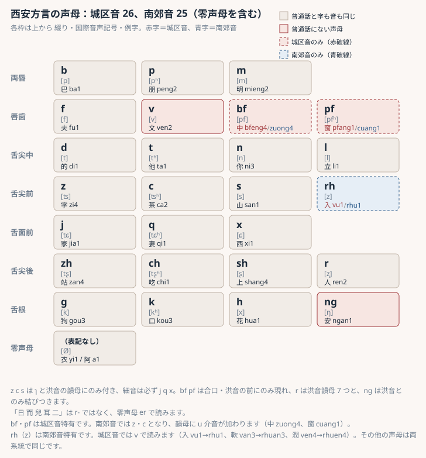
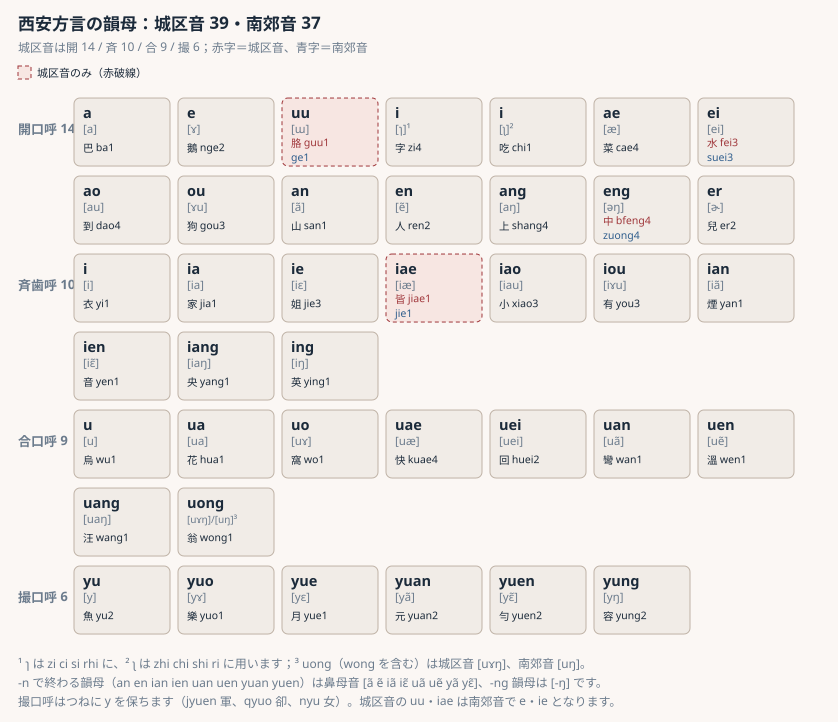
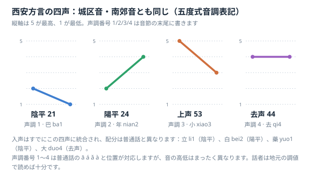
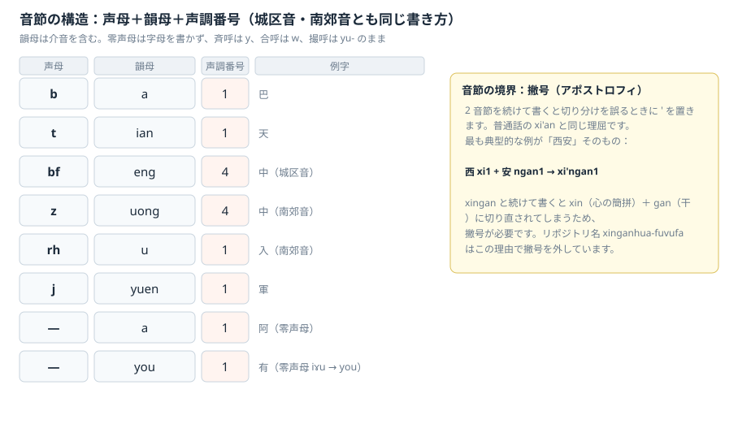
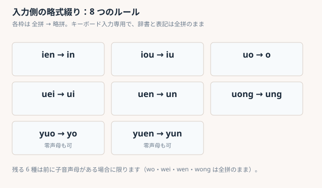
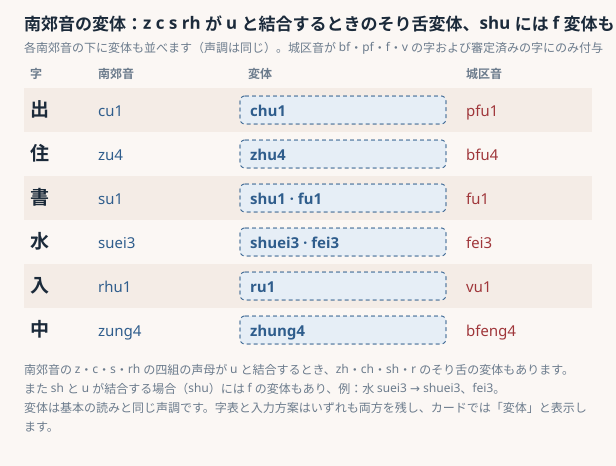

[简体中文](README.md) ｜ [繁體中文](README.zh-Hant.md) ｜ [English](README.en.md) ｜ **日本語**

# 西安方言入力法 · Android 直装版 · android-xinganhua

> [fcitx5-android](https://github.com/fcitx5-android/fcitx5-android)（小企鹅输入法）に西安方言の 2 方案を組み込んだ Android 向け直装パッケージです。本体と Rime プラグインを入れて「中州韵」をデプロイすれば、**西安話城區音**と**西安話南郊音**をすぐ入力できます。

- **対応 OS**：Android 6.0 以降（`minSdk 23`）、4 ABI（`arm64-v8a` / `armeabi-v7a` / `x86` / `x86_64`）
- **配布 APK**：全 8 個（本体 × 4 ABI ＋ Rime プラグイン × 4 ABI、共通鍵署名）
- **内蔵方案**：`chengqyu`（城区音）・`nanjiao`（南郊音）を `rime-data` に同梱し `schema_list` 先頭に配置
- **パッケージ名**：`org.fcitx.fcitx5.android`（公式版と同名で署名が異なるため、導入前に公式版を削除してください）
- **方案原本**：[xinganhua-fuvufa](https://github.com/SiqYin/xinganhua-fuvufa)

---

## 目次

1. [西安方言ピンイン方案](#s1)
2. [リポジトリの役割](#s2)
3. [入手と導入手順](#s3)
4. [組み込み構成](#s4)
5. [方案原本と一体型パッケージ](#s5)
6. [セルフビルド](#s6)
7. [上流と謝辞](#s7)
8. [ライセンス](#s8)

---

<a id="s1"></a>

## 1. 西安方言ピンイン方案

Android 版・PC 版 Rime・Web 字音検索サイトはいずれも共通の**西安方言ピンイン**を採用しています（`ba1` 巴・`jyuen1` 軍；「中」は城区音 `bfeng4`、南郊音 `zuong4`）：

- **声母**：共通 24（零声母を含む）に加え、城区音のみ `bf`・`pf`（26）、南郊音のみ `rh`（25）。配列は `b p m bf pf f v` / `d t n l` / `g k h ng` / `j q x` / `zh ch sh r` / `z c s rh`（`n` は `i`・`y` 細音前で `[ȵ]`）。
- **韻母**：共通 37（開 13・斉 9・合 9・撮 6）に加え、城区音のみ `uu`・`iae` を持ち 39（開 14・斉 10・合 9・撮 6）。
- **四声**：陰平 31・陽平 24・上声 53・去声 55（旧入声は四声に合流）。入力時の調号は省略可能です。
- **区切りと簡拼**：誤分割を防ぐ箇所に `'` を置きます（`xi'ngan1` 西安）。入力簡拼は子音後の `in / iu / o / ui / un / ung` と零声母を含む `yo / yun` の 8 種に対応します。







**連続変調**：二音節が続くときは前字が変化し、`31-31` は `24-31`、`53-53` は `31-53` となります。







**南郊音の変体**：南郊音の `z`・`c`・`s`・`rh`＋`u` にそり舌変体（`zh`・`ch`・`sh`・`r`）があり、`sh+u` には `f` 変体も置かれます。城区音が `bf`・`pf`・`f`・`v` の字と審定済み渭南独自字に付与されます（例：水 `suei3` → `shuei3`・`fei3`）。

詳細は [xinganhua-fuvufa](https://github.com/SiqYin/xinganhua-fuvufa)（[简体](https://github.com/SiqYin/xinganhua-fuvufa/blob/main/README.md) ／ [繁體](https://github.com/SiqYin/xinganhua-fuvufa/blob/main/README.zh-Hant.md) ／ [English](https://github.com/SiqYin/xinganhua-fuvufa/blob/main/README.en.md) ／ [日本語](https://github.com/SiqYin/xinganhua-fuvufa/blob/main/README.ja.md)）、字音検索は [xinganhua-ziyencaxin](https://siqyin.github.io/xinganhua-ziyencaxin/) をご参照ください。

---

<a id="s2"></a>

## 2. リポジトリの役割

上流 `fcitx5-android` 本体には手を加えず、次の 3 点のみを行います：

1. `chengqyu`・`nanjiao` の 6 つの `.yaml` を Rime プラグインの `rime-data` へ同梱し、`default.yaml` の先頭へ登録。
2. 本体と Rime プラグインを同一鍵で署名し、プラグイン認識を保証。
3. CI で `:app` と `:plugin:rime`（各 4 ABI）のみをビルド・配布。

---

<a id="s3"></a>

## 3. 入手と導入手順

### 3.1 APK の取得

[Releases](https://github.com/SiqYin/android-xinganhua/releases)（例：`v1.1.11`、計 8 APK）または `Build Custom APK` の成果物から取得します：

- 本体：`org.fcitx.fcitx5.android-…-<abi>-release.apk`
- プラグイン：`org.fcitx.fcitx5.android.plugin.rime-…-<abi>-release.apk`

現行端末の多くは **`arm64-v8a`**（旧 32 bit 機は `armeabi-v7a`、エミュレータは `x86` / `x86_64`）。**本体とプラグインは必ず同一 ABI** を選んでください。

### 3.2 公式版の事前削除

パッケージ名が公式版と同一で署名が異なるため、導入前に公式版および他改変版をアンインストールしてください。

### 3.3 初期設定

1. 本体と同一 ABI の Rime プラグインの両方をインストールします。
2. Android の「言語と入力」設定で **Fcitx5** を有効にします。
3. アプリ内の「入力法」から **中州韵（Rime）** を追加し、Rime 設定画面で一度 **デプロイ（Deploy）** を実行します。
4. 方案メニューから **西安話城區音** または **西安話南郊音** を選びます（`ba1` → 巴、`bfeng4` → 中、`nge3` → 我。調号省略可）。

### 3.4 よくある確認点

| 症状 | 確認事項 |
|---|---|
| 「中州韵」が出ない | Rime プラグイン未導入、または本体と異なる ABI を導入 |
| 「西安話」が出ない | Rime 設定でデプロイを実行していない |
| 英語しか打てない | 現在の入力法が Rime に切り替わっていない |
| `` ` `` 逆引きが効かない | 同バージョンの Rime プラグイン（`luna_pinyin` 同梱）を入れ直す |

---

<a id="s4"></a>

## 4. 組み込み構成

```
plugin/rime/src/main/cpp/rime-xinganhua/   xinganhua-fuvufa から同期した 6 ファイル
├── chengqyu.schema.yaml                   城区音スキーマ
├── chengqyu.dict.yaml                     城区音メイン辞書
├── chengqyu.word.dict.yaml                城区音単字表（3,649 件）
├── nanjiao.schema.yaml                    南郊音スキーマ（25 声母・37 韻母）
├── nanjiao.dict.yaml                      南郊音メイン辞書
└── nanjiao.word.dict.yaml                 南郊音単字表（4,594 件）
plugin/rime/src/main/cpp/default.yaml      chengqyu / nanjiao を先頭に配置
plugin/rime/src/main/cpp/CMakeLists.txt    rime-data へのインストール設定
.github/workflows/build-custom.yml         :app と :plugin:rime の 8 APK をビルド
```

普通話逆引きはプラグイン同梱の `luna_pinyin` を使用します（`x` は正規声母のため画数逆引きは廃止済み）。APK バージョン名は `nanjiao.word.dict.yaml` の `version` から自動取得します。

---

<a id="s5"></a>

## 5. 方案原本と一体型パッケージ

```
MCPDict「西安」データ表（IPA）
        │  tools/ipa2pinyin.mjs
        ▼
xinganhua-fuvufa（方案・辞書・図版）
        │  6 つの yaml を同期
        ▼
android-xinganhua（本体 + Rime プラグイン → 8 APK）
```

| 項目 | 城区音（`chengqyu`） | 南郊音（`nanjiao`） |
|---|---|---|
| 収録件数 | 3,649 | 4,594 |
| 見出し字 | 3,346 | 4,065（追加 720 字を含む） |
| 多音字 | 275 | 428（変体除き 256） |
| 声調別除く音節数 | 392 | 420 |

字音の修正はすべて [xinganhua-fuvufa](https://github.com/SiqYin/xinganhua-fuvufa) 側で行い、更新後に 6 つの `.yaml` を本リポジトリへ反映します。

### 一体型パッケージ：小鳶入力法（Iris Keyboard）

本体・プラグインの別インストールや初回デプロイを省きたい場合は、西安方言 2 方案と呉語 2 方案の事前コンパイル済み辞書を 1 本の APK にまとめた [小鳶入力法 Iris Keyboard](https://github.com/SiqYin/fcitx5-iris) もご利用いただけます。

---

<a id="s6"></a>

## 6. セルフビルド

上流と同じビルド環境（Android SDK・NDK・CMake・`extra-cmake-modules`・`gettext`・`git submodule update --init --recursive`）を整えた上で実行します：

```sh
./gradlew :app:assembleRelease
./gradlew :plugin:rime:assembleRelease
```

---

<a id="s7"></a>

## 7. 上流と謝辞

- [fcitx5-android](https://github.com/fcitx5-android/fcitx5-android)・[fcitx5](https://github.com/fcitx/fcitx5)・[librime](https://github.com/rime/librime)。
- [xinganhua-fuvufa](https://github.com/SiqYin/xinganhua-fuvufa) —— 西安方言ピンイン方案と辞書本体。
- [西安話](https://github.com/osfans/MCPDict/blob/master/tools/tables/data/%E8%A5%BF%E5%AE%89.tsv)・[渭南話](https://github.com/osfans/MCPDict/blob/master/tools/tables/data/%E6%B8%AD%E5%8D%97.tsv)・[華県話](https://github.com/osfans/MCPDict/blob/master/tools%2Ftables%2Fdata%2F%E5%8D%8E%E5%8E%BF.tsv)・[臨潼話](https://github.com/osfans/MCPDict/blob/master/tools%2Ftables%2Fdata%2F%E4%B8%B4%E6%BD%BC%E6%96%B9%E8%A8%80%E8%AF%AD%E9%9F%B3%E7%A0%94%E7%A9%B6.tsv) の各資料（[osfans/MCPDict](https://github.com/osfans/MCPDict)）。南郊話の資料は参考データとして整理したものです。
- [fcitx5-wugniu](https://github.com/SiqYin/fcitx5-wugniu) —— パッケージングと CI 構成の参照元。

---

<a id="s8"></a>

## 8. ライセンス

上流の **LGPL-2.1**（`LICENSE`）に準じます。同梱する西安方言方案は [xinganhua-fuvufa](https://github.com/SiqYin/xinganhua-fuvufa)、原音データは MCPDict の各規定に従います。
