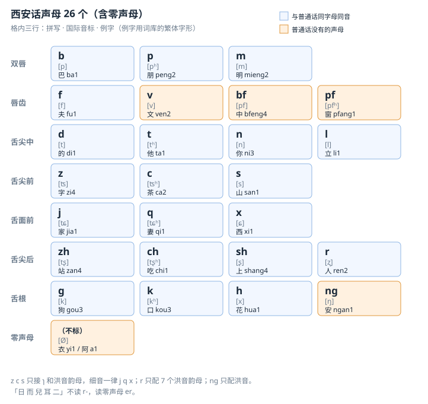
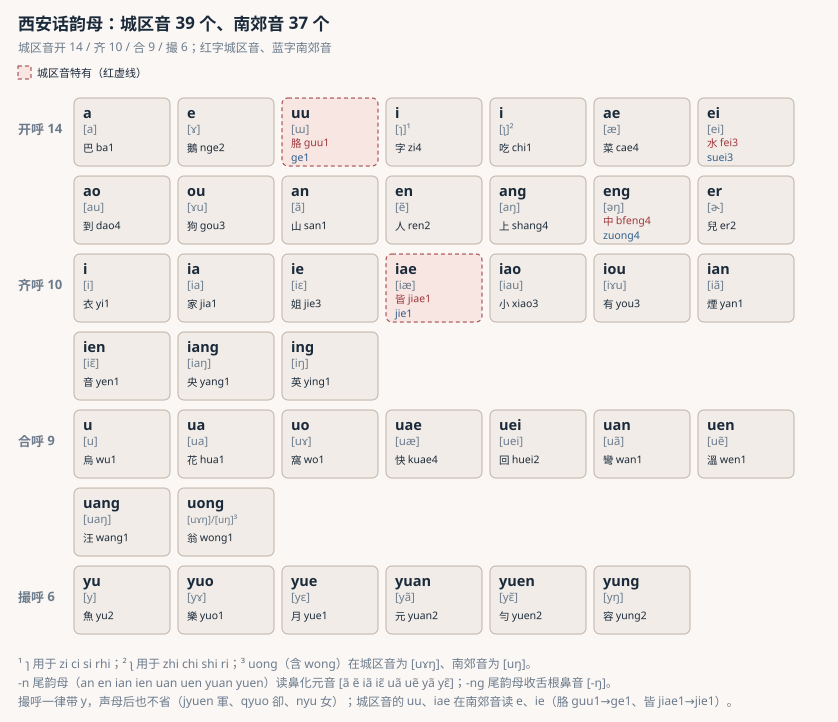
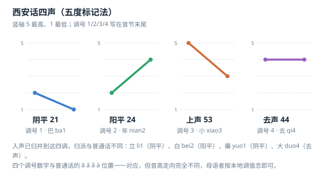
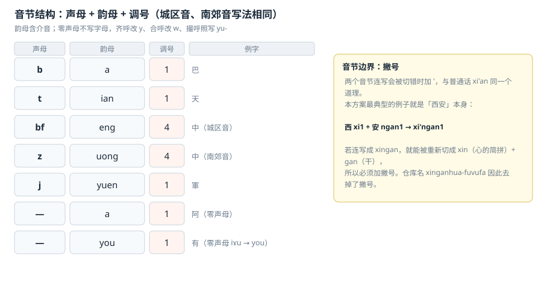
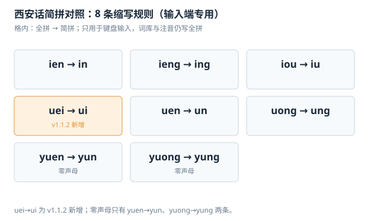
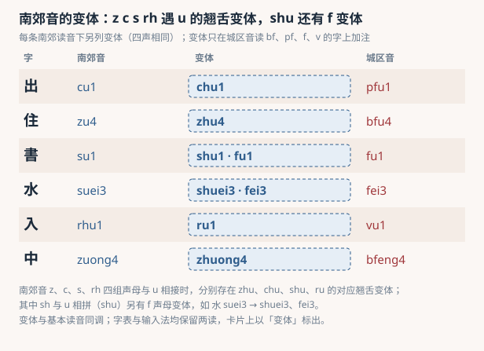

**简体中文** ｜ [繁體中文](README.zh-Hant.md) ｜ [English](README.en.md) ｜ [日本語](README.ja.md)

# 西安话输入法 · 安卓直装版 · android-xinganhua

> 把西安话输入法做成安卓直装包：装上**小企鹅输入法**（Fcitx5 for Android）的**本体**与 **Rime 插件**，切到「中州韵」再选「西安話城區音」或「西安話南郊音」，就能用西安话拼音打字——不必自己往手机里导入方案。

- **平台**：Android 6.0 及以上（minSdk 23）；`arm64-v8a` / `armeabi-v7a` / `x86` / `x86_64` 四个 ABI
- **发布物**：8 个 APK = 本体 × 4 ABI ＋ Rime 插件 × 4 ABI，都是同一把密钥签名
- **内置方案**：`chengqyu`（西安话城区音）、`nanjiao`（西安话南郊音），随插件装进 `rime-data`，在方案选单里排前两位
- **包名**：`org.fcitx.fcitx5.android`（与官方版相同、签名不同；装前先卸掉官方版）
- **方案源库**：[xinganhua-fuvufa](https://github.com/SiqYin/xinganhua-fuvufa)（只读引用，本仓库不改方案内容）
- **四种语言**：简体 / 繁体 / English / 日本語，顶部的链接可直接切换；四版内容一致，以简体版为准

---

## 目录

1. [西安话拼音方案](#s1)
2. [这是什么](#s2)
3. [下载与安装](#s3)
4. [内置方式：本仓库改了什么](#s4)
5. [与方案仓库的关系](#s5)
6. [自行构建](#s6)
7. [上游与致谢](#s7)
8. [授权](#s8)

---

<a id="s1"></a>

## 一、西安话拼音方案

无论是手机上的小企鹅，还是电脑上的 Rime、另外两个仓库，用的都是同一套**西安话拼音**，城区音、南郊音各一套。一个音节写成「声母 + 韵母 + 调号」，例如 `ba1` 巴、`jyuen1` 軍；`bfeng4` 中是城区音，南郊音作 `zuong4`：

- **声母**：两套共用 24 个（含零声母），城区音另有 `bf`、`pf`（共 26），南郊音另有 `rh`（共 25）：`b p m f v bf pf d t n l z c s rh j q x zh ch sh r g k h ng`
- **韵母**：两套共用 38 个（开 15 ／ 齐 8 ／ 合 9 ／ 撮 6），城区音另有 `uu`、`iae`，共 40 个（开 16 ／ 齐 9 ／ 合 9 ／ 撮 6）
- **四声**：阴平 21、阳平 24、上声 53、去声 44；入声已并入四调
- **调号紧贴音节**，不空格：`bfeng4` 中、`jyuen1` 軍
- **音节边界用撇号**：`xi'ngan1` 西安（否则会被切成 xin 心 + gan 干）
输入端可用简拼：`in / ing / iu / ui / un / ung / yun / yung`（分别对应 `ien / ieng / iou / uei / uen / uong / yuen / yuong`；零声母只放行 `yuen`、`yuong`）；调号不输入。

下面六张图把方案讲全（与其他两个仓库用的是同一套图，各语言版本内容一致）：







西安话的连读变调主要是前字变调，分为两类：连续两字为一声（阴平）21-21 时，第一个一声字改读二声（阳平）24-21；连续两字为三声（上声）53-53 时，第一个三声字改读一声（阴平）21-53。







**南郊音变体**：南郊音 z、c、s、rh 四组声母与 u 相接时，分别存在 zhu、chu、shu、ru 的对应翘舌变体；其中 sh 与 u 相拼（shu）另有 f 声母变体。上述变体只在城区音读 bf、pf、f、v 的字上加注，例如「水」南郊音 `suei3` 另有变体 `shuei3`、`fei3`；变体与基本读音同调，字表中另立一行并注明「变体」。


方案的完整说明——声母韵母的分布规则、正字法细则、与普通话拼音的逐条对照、可用的简拼——见输入法仓库的 [README](https://github.com/SiqYin/xinganhua-fuvufa)（[简体](https://github.com/SiqYin/xinganhua-fuvufa/blob/main/README.md) ／ [繁體](https://github.com/SiqYin/xinganhua-fuvufa/blob/main/README.zh-Hant.md) ／ [English](https://github.com/SiqYin/xinganhua-fuvufa/blob/main/README.en.md) ／ [日本語](https://github.com/SiqYin/xinganhua-fuvufa/blob/main/README.ja.md)）。查字音可以用[字音查询站](https://siqyin.github.io/xinganhua-ziyencaxin/)。

---

<a id="s2"></a>

## 二、这是什么

本仓库是 [fcitx5-android](https://github.com/fcitx5-android/fcitx5-android)（小企鹅输入法）的定制分支，专门为西安话做安卓直装包。

小企鹅输入法本身是个输入法**框架**——Fcitx5 的安卓移植，自带键盘、候选栏、主题，中文输入则交给插件：拼音、双拼、五笔、仓颉，以及能加载任意 Rime 方案的 **Rime 插件（中州韵）**。

所以这里不重写输入法，只做三件事：

1. **把方案放进插件**：`chengqyu`、`nanjiao` 两套方案的六个文件随 Rime 插件装进 `rime-data`，并在 `default.yaml` 的 `schema_list` 里排前两位；
2. **统一签名**：本体与插件用同一把发布密钥，插件才会被本体认下来；
3. **把包发出来**：只构建本体与 Rime 插件，四个 ABI 各一套，附这份安装说明。

换句话说，我们发布的内容就是：**改过、内置了西安话城区音与南郊音两套方案的小企鹅输入法本体** ＋ **同一个 Rime 插件** ＋ **下载安装使用的引导**。装的还是小企鹅，只是开箱就能打西安话。

---

<a id="s3"></a>

## 三、下载与安装

### 3.1 取包

- **Releases**（推荐）：<https://github.com/SiqYin/android-xinganhua/releases> ，最新版（写作时为 `v1.1.1`）共 8 个 APK：
  - 本体：`org.fcitx.fcitx5.android-…-<abi>-release.apk`
  - 插件：`org.fcitx.fcitx5.android.plugin.rime-…-<abi>-release.apk`
- **Actions**：`Build Custom APK` 工作流的产物里，`fcitx5-android-custom` 是本体，`fcitx5-plugins` 里是 Rime 插件。

ABI 怎么选：现在的手机基本都选 **`arm64-v8a`**；很老的 32 位机选 `armeabi-v7a`；模拟器按自己的架构选 `x86` / `x86_64`。**本体和插件必须是同一个 ABI**，否则插件不会被加载。

### 3.2 先卸掉官方版

本包与官方小企鹅**同包名**（`org.fcitx.fcitx5.android`）但**签名不同**，两者不能共存，也不能互相覆盖升级。装之前请先卸载机器上的官方版（以及其它改版），再装本包。

### 3.3 安装顺序

1. 装**本体**（`org.fcitx.fcitx5.android-…`）；
2. 装 **Rime 插件**（`org.fcitx.fcitx5.android.plugin.rime-…`）；
3. 两个都装完再打开输入法，先装插件后装本体也可以，但**都要装**。

### 3.4 启用输入法

系统设置 →「语言和输入法」→「屏幕键盘 / 管理键盘」→ 打开 **Fcitx5**（小企鹅输入法）→ 在输入法选择器里切到它。不同厂商的设置路径略有出入，找不到就搜「输入法」。

### 3.5 加上「中州韵」，选「西安話」

1. 打开小企鹅输入法的 App，进「输入法」页，点「＋」添加 **中州韵（Rime）**；
2. 在 Rime 的设置里点一次 **部署**（Deploy），让插件把 `rime-data` 里的方案编译出来；
3. 回到键盘，用方案选单（〔方案選單〕，或 `Ctrl` + `` ` ``、`F4`）切到 **西安話城區音** 或 **西安話南郊音**；
4. 直接打：`ba1` → 巴，`bfeng4` → 中，`nge3` → 我。调号可省，打 `ba` 出四个调。

### 3.6 打不出西安话？

| 现象 | 先查 |
|---|---|
| 输入法列表里没有「中州韵」 | 插件没装，或装成了另一个 ABI；补装同 ABI 的 Rime 插件 |
| 有「中州韵」但没有「西安話」 | 没点「部署」，或部署失败；进 Rime 设置重新部署一次 |
| 能打英文，中文出不来 | 键盘上的输入法没切到 Rime（看空格键旁的方案名） |
| 反查（`` ` `` + 普通话拼音）不可用 | `luna_pinyin` 没随插件装上；重装同版本的 Rime 插件 |

---

<a id="s4"></a>

## 四、内置方式：本仓库改了什么

```
plugin/rime/src/main/cpp/rime-xinganhua/   两套方案（拷贝自 xinganhua-fuvufa）
├── chengqyu.schema.yaml                   西安话城区音：字母表、简拼演算、反查 ` 起头
├── chengqyu.dict.yaml                     城区音主词典，import_tables 指向字音表
├── chengqyu.word.dict.yaml                城区音字音表 3,648 条
├── nanjiao.schema.yaml                    西安话南郊音（声母 25 含 rh、韵母 38）
├── nanjiao.dict.yaml                      南郊音主词典
└── nanjiao.word.dict.yaml                 南郊音字音表 4,594 条
plugin/rime/src/main/cpp/default.yaml      schema_list 前两项 = chengqyu、nanjiao
plugin/rime/src/main/cpp/CMakeLists.txt    三个文件安装到 rime-data
.github/workflows/build-custom.yml         只构建 :app 与 :plugin:rime，出 8 个 APK
```

- 方案是**拷贝**进来的，不是 submodule。方案仓库更新后，要重新同步这六个文件再出包，两边不会自动跟。
- 反查只依赖 `luna_pinyin`（普通话），它本来就在随插件的方案列表里，所以方案里不用再带。笔画反查已撤除（`x` 是西安话拼音的正式声母）。
- CI 只出两类包：本体和 Rime 插件。其它插件（注音、粤拼、日文、韩文……）不打包，包体和上游一致，不会因为多带插件而变大。
- 本体与插件都用 `SIGN_KEY_BASE64` / `SIGN_KEY_PWD` / `SIGN_KEY_ALIAS` 这三项 secrets 签名；缺一项，CI 直接失败，避免发出装不上的包。

---

<a id="s5"></a>

## 五、与方案仓库的关系

```
MCPDict《西安》数据表（国际音标）
        │  tools/ipa2pinyin.mjs
        ▼
xinganhua-fuvufa（方案、字表、说明）
        │  拷贝三个 yaml
        ▼
android-xinganhua（本体 + Rime 插件 → 8 个 APK）
```

| 项 | 城区音 | 南郊音 |
|---|---|---|
| 字音条目 | 3,648 | 4,594（一字一音一行） |
| 字头 | 3,345 | 4,065（含渭南独有等新增 720 字） |
| 多音字 | 275 | 223 |
| 不计调音节 | 392 | 420 |

本仓库不改方案内容：发现读音或拼写有问题，请改 [xinganhua-fuvufa](https://github.com/SiqYin/xinganhua-fuvufa) 的字表（城区音 `data/source.tsv`、南郊音字表）后重跑生成脚本，再把新的六个文件同步过来。

### 一体包：小鸢输入法

[小鸢输入法 Iris Keyboard](https://github.com/SiqYin/fcitx5-iris)（`SiqYin/fcitx5-iris`）把本体与 Rime 插件打成一个 APK，
内置西安话城区音/南郊音与吴语两方案共四套方案，词库在构建机上预编译，装完即用、无需手动部署。
**今后请直接下载安装小鸢输入法**：本仓库的维护已转入
[小鸢输入法](https://github.com/SiqYin/fcitx5-iris)（`SiqYin/fcitx5-iris`），那里提供吴语版（默认吴语混合腔）
与西安话版（默认西安话南郊音）两个安装包，两者都内置全部四个方案，装完即用。本仓库保留作历史版本，不再更新。

---

<a id="s6"></a>

## 六、自行构建

构建方式与上游一致（Android SDK、NDK、CMake、`extra-cmake-modules`、`gettext`，以及 `git submodule update --init --recursive`），细节见上游 README。本仓库只关心两个模块：

```sh
./gradlew :app:assembleRelease            # 本体
./gradlew :plugin:rime:assembleRelease    # Rime 插件
```

本地出正式包同样需要签名配置；没有密钥时可以先出 debug 包自用（debug 与 release 签名不同，插件要装同一次构建的 debug 版本才会被识别）。

---

<a id="s7"></a>

## 七、上游与致谢

- [fcitx5-android](https://github.com/fcitx5-android/fcitx5-android)（小企鹅输入法）——本仓库的上游，键盘、框架与插件体系都来自这里
- [fcitx5](https://github.com/fcitx/fcitx5) 与 [librime](https://github.com/rime/librime) ——框架与 Rime 引擎
- [xinganhua-fuvufa](https://github.com/SiqYin/xinganhua-fuvufa) ——西安话拼音方案、字表与四语说明
- [西安话音档](https://github.com/osfans/MCPDict/blob/master/tools/tables/data/%E8%A5%BF%E5%AE%89.tsv)、[渭南话音档](https://github.com/osfans/MCPDict/blob/master/tools/tables/data/%E6%B8%AD%E5%8D%97.tsv)、[华县话音档](https://github.com/osfans/MCPDict/blob/master/tools%2Ftables%2Fdata%2F%E5%8D%8E%E5%8E%BF.tsv)、[临潼话音档](https://github.com/osfans/MCPDict/blob/master/tools%2Ftables%2Fdata%2F%E4%B8%B4%E6%BD%BC%E6%96%B9%E8%A8%80%E8%AF%AD%E9%9F%B3%E7%A0%94%E7%A9%B6.tsv)——均出自 [osfans/MCPDict](https://github.com/osfans/MCPDict)。西安话音档即城区音字音来源；南郊音参照西安话、渭南话、华县话、临潼话等音档逐字厘定。
- **南郊话音档**没有现成字表可依：以西安话、渭南话、临潼话、华县话音档等为基底，参照知乎上关于南郊音、东郊音平翘舌归并情况的讨论，并与本人及家人的口音逐字校对整理而成，因此**仅供参考**
- [fcitx5-wugniu](https://github.com/SiqYin/fcitx5-wugniu) ——吴语直装包，本仓库的打包做法参照

---

<a id="s8"></a>

## 八、授权

本仓库沿用上游的 **LGPL-2.1**（见 `LICENSE`）；对上游代码的修改同样按 LGPL-2.1 发布。西安话方案与字表来自 [xinganhua-fuvufa](https://github.com/SiqYin/xinganhua-fuvufa)，字音数据来自 MCPDict，版权与授权请遵循各自项目说明。

---

## 声明

简体版为源文；繁体版由 OpenCC 从简体转出，英文与日文版为对应译本。四版内容一致，如有出入以简体版为准。本文由 AI 辅助撰写与翻译。
