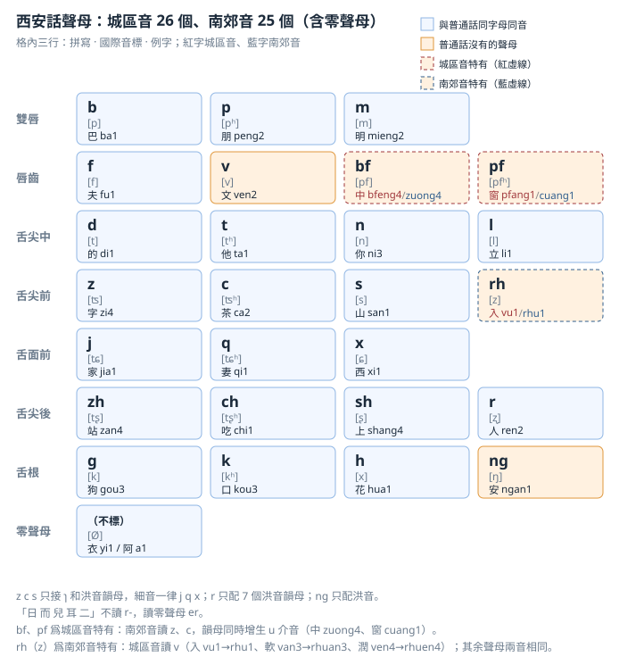
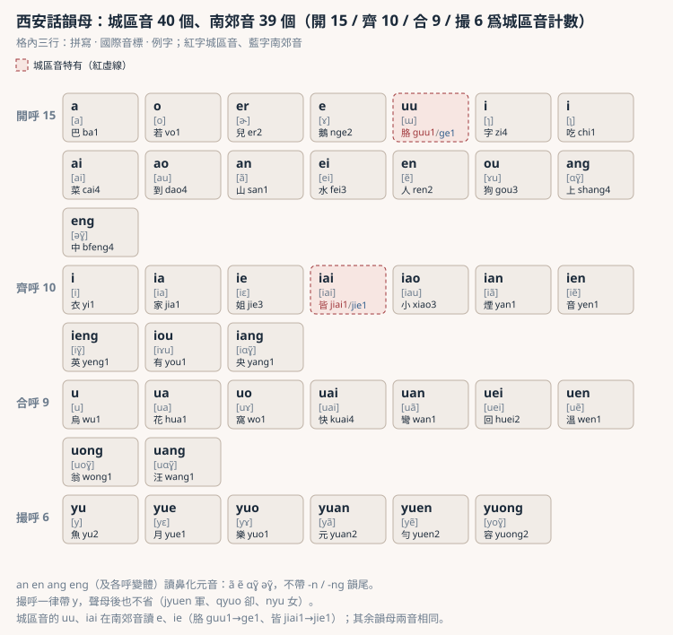
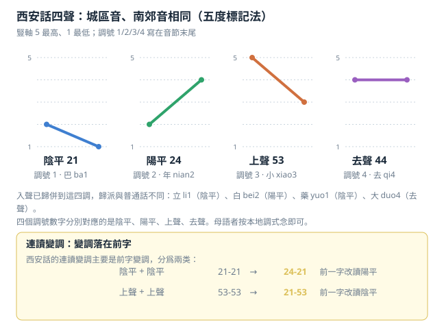
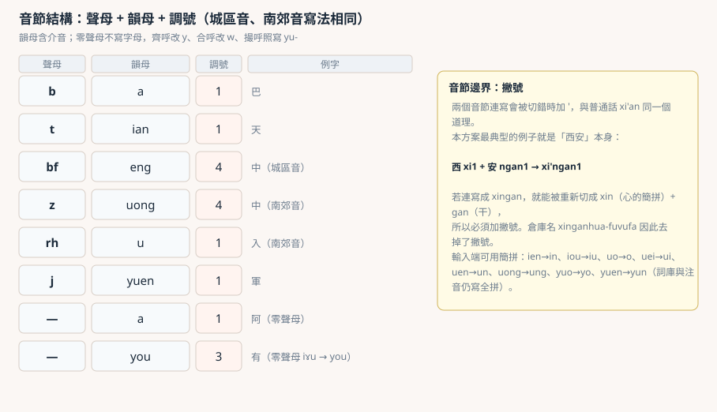
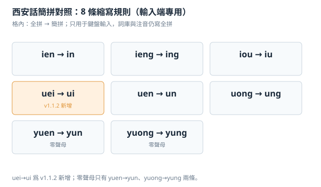
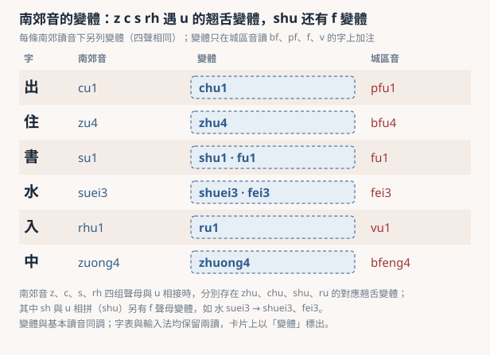

[简体中文](README.md) ｜ **繁體中文** ｜ [English](README.en.md) ｜ [日本語](README.ja.md)

# 西安話輸入法 · 安卓直裝版 · android-xinganhua

> 爲 [fcitx5-android](https://github.com/fcitx5-android/fcitx5-android)（小企鵝輸入法）預置西安話方案的安卓直裝包：安裝本體與 Rime 插件後切至「中州韻」，即可選用**西安話城區音**或**西安話南郊音**直接打字，不必自行導入方案文件。

- **系統支持**：Android 6.0 及以上（`minSdk 23`），提供 `arm64-v8a` / `armeabi-v7a` / `x86` / `x86_64` 四個 ABI
- **發佈產物**：8 個 APK（輸入法本體 × 4 ABI ＋ Rime 插件 × 4 ABI），共用同一把簽名密鑰
- **內置方案**：`chengqyu`（西安話城區音）、`nanjiao`（西安話南郊音），編入插件 `rime-data` 並列於方案選單前兩位
- **包名約定**：`org.fcitx.fcitx5.android`（與上游同包名而簽名不同，裝前需先卸載官方版）
- **方案源庫**：[xinganhua-fuvufa](https://github.com/SiqYin/xinganhua-fuvufa)（本倉只打包同步，不單獨改字音）

---

## 目錄

1. [西安話拼音方案](#s1)
2. [項目定位](#s2)
3. [下載與安裝](#s3)
4. [內置結構說明](#s4)
5. [與方案庫及小鳶一體包的關係](#s5)
6. [本地自行構建](#s6)
7. [上游與致謝](#s7)
8. [授權許可](#s8)

---

<a id="s1"></a>

## 一、西安話拼音方案

本直裝包、桌面端 Rime 與在線字音站共用同一套**西安話拼音**（含城區音、南郊音兩套字表）。音節由「聲母 + 韻母 + 調號」組成，例如 `ba1` 巴、`jyuen1` 軍；「中」在城區音作 `bfeng4`，在南郊音作 `zung4`：

- **聲母**：兩支共用 24 個（含零聲母），城區音另有 `bf`、`pf`（共 26），南郊音另有 `rh`（共 25）。依次排作：`b p m bf pf f v` / `d t n l` / `g k h ng` / `j q x` / `zh ch sh r` / `z c s rh`（`n` 逢 `i`、`y` 細音讀 `[ȵ]`）。
- **韻母**：城區音 39 個（開 14 ／ 齊 10 ／ 合 9 ／ 撮 6，含 `uu`、`iae`、`uong`），南郊音 37 個（開 13 ／ 齊 9 ／ 合 9 ／ 撮 6，無 `uu`、`iae`，合口鼻尾韻直接拼作 `ung`）。
- **四聲**：陰平 31、陽平 24、上聲 53、去聲 55，古入聲已併入四調；調號緊貼音節末尾，打字時可省略。
- **隔音撇號**：音節連寫易誤切處用 `'` 隔開（如 `xi'ngan1` 西安）。
- **輸入簡拼**：兩支共用的規則爲 `in / iu / o / ui / un`（限前有輔音聲母，對應 `ien / iou / uo / uei / uen`）、`o`（`j q x` 後的 `yuo`：`jo / qo / xo`）、`yo`（零聲母與 `n` 後的 `yuo`）與 `yun`（對應 `yuen`）；至於 `uong → ung`，**城區音中拼音可以這樣簡化，南郊音本來的拼寫就是後者（`ung`）**。

下面六張圖展示完整音系與拼寫規則：







**連讀變調**：兩字連讀主要由前字變調——連續兩個陰平（`31-31`）前字改讀陽平（`24-31`）；連續兩個上聲（`53-53`）前字改讀陰平（`31-53`）。







**南郊音變體**：南郊音 `z`、`c`、`s`、`rh` 接 `u` 韻母時另有 `zh`、`ch`、`sh`、`r` 翹舌變體，其中 `sh` 拼 `u` 時另有 `f` 變體；變體只加注在城區音讀 `bf`、`pf`、`f`、`v` 的字及審定的渭南獨有字上（如「水」南郊作 `suei3`，另有變體 `shuei3`、`fei3`），與本讀音同調並一併編入詞庫。

完整的分布細則與普通話對照詳見 [xinganhua-fuvufa](https://github.com/SiqYin/xinganhua-fuvufa)（[簡體](https://github.com/SiqYin/xinganhua-fuvufa/blob/main/README.md) ／ [繁體](https://github.com/SiqYin/xinganhua-fuvufa/blob/main/README.zh-Hant.md) ／ [English](https://github.com/SiqYin/xinganhua-fuvufa/blob/main/README.en.md) ／ [日本語](https://github.com/SiqYin/xinganhua-fuvufa/blob/main/README.ja.md)）；單字查音可訪問[字音查詢站](https://siqyin.github.io/xinganhua-ziyencaxin/)。

---

<a id="s2"></a>

## 二、項目定位

本倉庫是 [fcitx5-android](https://github.com/fcitx5-android/fcitx5-android) 的定製打包分支，不動用輸入法上層交互與核心引擎，只負責三項打包工作：

1. **預置方案**：將 `chengqyu` 與 `nanjiao` 的六個 `.yaml` 文件隨 Rime 插件寫入 `rime-data`，並在 `default.yaml` 的 `schema_list` 中置頂；
2. **統一簽名**：用同一把簽名證書籤署本體與 Rime 插件，使插件能被本體正常加載；
3. **精簡產物**：CI 僅構建 `:app` 與 `:plugin:rime` 兩個模塊（各 4 個 ABI），不夾帶其餘語言插件。

---

<a id="s3"></a>

## 三、下載與安裝

### 3.1 獲取安裝包

- **Releases**（推薦）：<https://github.com/SiqYin/android-xinganhua/releases> ，新版（如 `v1.1.13`）附帶 8 個 APK：
  - 本體：`org.fcitx.fcitx5.android-…-<abi>-release.apk`
  - 插件：`org.fcitx.fcitx5.android.plugin.rime-…-<abi>-release.apk`
- **Actions**：`Build Custom APK` 產物中的 `fcitx5-android-custom` 爲本體、`fcitx5-plugins` 內爲 Rime 插件。

**ABI 選擇**：現代手機大多選 **`arm64-v8a`**；老舊 32 位設備選 `armeabi-v7a`；模擬器按宿主架構選 `x86` 或 `x86_64`。**本體與插件必須同 ABI**。

### 3.2 卸載衝突版本

本包與官方版小企鵝同用 `org.fcitx.fcitx5.android` 包名但簽名不同，安裝前請先卸載手機上的官方版及其他第三方簽名改版，否則系統會拒裝。

### 3.3 安裝與啓用

1. 安裝同 ABI 的**本體** APK 與 **Rime 插件** APK（安裝順序任意，兩者須齊全）。
2. 在系統「語言和輸入法」設置中啓用 **Fcitx5** 並設爲當前鍵盤。
3. 打開小企鵝 App →「輸入法」→ 點擊「＋」添加 **中州韻（Rime）**，進 Rime 設置點一次 **部署**（Deploy）。
4. 回到鍵盤通過方案選單切至 **西安話城區音** 或 **西安話南郊音** 即可輸入（如 `ba1` → 巴、`bfeng4` → 中、`nge3` → 我；省去調號也可）。

### 3.4 常見排查

| 現象 | 排查方向 |
|---|---|
| 列表裏找不到「中州韻」 | 未安裝 Rime 插件，或本體與插件 ABI 不一致 |
| 有「中州韻」卻看不到「西安話」 | 初次未點「部署」，或部署失敗；進 Rime 設置重新部署 |
| 只能出英文不出漢字 | 當前鍵盤停留在英文方案，點擊空格旁方案名切到 Rime |
| 普通話反查（`` ` `` + 拼音）無效 | `luna_pinyin` 未隨插件到位，重裝同版本 Rime 插件 |

---

<a id="s4"></a>

## 四、內置結構說明

```
plugin/rime/src/main/cpp/rime-xinganhua/   兩套西安話方案（同步自 xinganhua-fuvufa）
├── chengqyu.schema.yaml                   城區音方案（簡拼演算與 ` 反查）
├── chengqyu.dict.yaml                     城區音主詞典
├── chengqyu.word.dict.yaml                城區音字音表（3,649 條）
├── nanjiao.schema.yaml                    南郊音方案（25 聲母、37 韻母）
├── nanjiao.dict.yaml                      南郊音主詞典
└── nanjiao.word.dict.yaml                 南郊音字音表（4,596 條）
plugin/rime/src/main/cpp/default.yaml      schema_list 置頂 chengqyu、nanjiao
plugin/rime/src/main/cpp/CMakeLists.txt    將方案與詞典安裝進 rime-data
.github/workflows/build-custom.yml         構建 :app 與 :plugin:rime，生成 8 APK
```

普通話反查依賴內置的 `luna_pinyin`；`x` 已作爲西安話正式聲母，舊筆畫反查已隨方案撤除。構建機以 `nanjiao.word.dict.yaml` 中的 `version` 字段作爲 APK 版本名基準，並由 `SIGN_KEY_BASE64` / `SIGN_KEY_PWD` / `SIGN_KEY_ALIAS` 統一簽名。

---

<a id="s5"></a>

## 五、與方案庫及小鳶一體包的關係

```
MCPDict《西安》數據表（國際音標）
        │  tools/ipa2pinyin.mjs
        ▼
xinganhua-fuvufa（方案、字表、配圖）
        │  同步六個 yaml
        ▼
android-xinganhua（本體 + Rime 插件 → 8 個 APK）
```

| 項 | 城區音 | 南郊音 |
|---|---|---|
| 字音條目 | 3,649 | 4,596（一字一音一行） |
| 字頭 | 3,346 | 4,065（含增補 720 字） |
| 多音字 | 275 | 428（不含變體 256） |
| 不計調音節 | 392 | 421 |

字音修訂均在 [xinganhua-fuvufa](https://github.com/SiqYin/xinganhua-fuvufa) 完成，之後再把六個 `.yaml` 同步到本倉重新打包。

### 一體包：小鳶輸入法（Iris Keyboard）

若希望免去「先裝本體再裝插件並手動部署」的步驟，可直接選用 [小鳶輸入法 Iris Keyboard](https://github.com/SiqYin/fcitx5-iris)（`SiqYin/fcitx5-iris`）。該倉庫將本體與 Rime 插件合入單個 APK，預編譯好西安話（城區音／南郊音）與吳語方案共四套詞庫，安裝後即可直接使用。

---

<a id="s6"></a>

## 六、本地自行構建

構建環境與上游一致（Android SDK、NDK、CMake、`extra-cmake-modules`、`gettext` 及 `git submodule update --init --recursive`），編譯核心模塊：

```sh
./gradlew :app:assembleRelease
./gradlew :plugin:rime:assembleRelease
```

---

<a id="s7"></a>

## 七、上游與致謝

- [fcitx5-android](https://github.com/fcitx5-android/fcitx5-android)、[fcitx5](https://github.com/fcitx/fcitx5) 與 [librime](https://github.com/rime/librime) —— 輸入法框架與 Rime 引擎。
- [xinganhua-fuvufa](https://github.com/SiqYin/xinganhua-fuvufa) —— 西安話拼音方案、詞庫與配圖。
- [西安話音檔](https://github.com/osfans/MCPDict/blob/master/tools/tables/data/%E8%A5%BF%E5%AE%89.tsv)、[渭南話音檔](https://github.com/osfans/MCPDict/blob/master/tools/tables/data/%E6%B8%AD%E5%8D%97.tsv)、[華縣話音檔](https://github.com/osfans/MCPDict/blob/master/tools%2Ftables%2Fdata%2F%E5%8D%8E%E5%8E%BF.tsv)、[臨潼話音檔](https://github.com/osfans/MCPDict/blob/master/tools%2Ftables%2Fdata%2F%E4%B8%B4%E6%BD%BC%E6%96%B9%E8%A8%80%E8%AF%AD%E9%9F%B3%E7%A0%94%E7%A9%B6.tsv)（[osfans/MCPDict](https://github.com/osfans/MCPDict)）。**南郊話音檔**在四檔底本上參考知乎關於南郊、東郊平翹舌合流討論並與家人日常讀音覈對整理而成，**僅供參考**。
- [fcitx5-wugniu](https://github.com/SiqYin/fcitx5-wugniu) —— 打包腳本與發佈流程參照。

---

<a id="s8"></a>

## 八、授權許可

本倉庫代碼遵循上游 **LGPL-2.1**（見 `LICENSE`）。內置西安話方案與詞庫源於 [xinganhua-fuvufa](https://github.com/SiqYin/xinganhua-fuvufa)，字音原始數據版權遵循 MCPDict 原項目說明。
